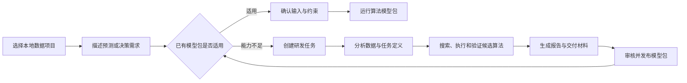

# AutoDecision

AutoDecision 是一个面向本地数据项目的自动决策与算法研发平台。用户用自然语言描述预测、优化或分析需求；系统可以调用已有算法模型包，也可以基于指定数据启动研发任务，将数据分析、候选算法搜索、验证和交付串成一条可追溯的工作流。

项目以本地部署为主。数据、任务、模型包和运行记录保存在用户自己的机器上；连接远程大语言模型服务时，请按下文的数据处理说明配置并评估数据出站范围。

## 功能

- **数据项目**：登记本机数据目录，关联研发任务、算法模型包和调用记录。
- **决策对话**：用自然语言提出需求，查看方案，确认输入后执行算法模型包；能力不足时可将需求整理为新的研发任务。
- **自动研发**：分析数据和任务约束，搜索、执行、比较候选算法，并保留运行过程和验证结果。
- **算法模型包**：将已完成研发的实现、模型、输入输出约定和来源信息整理为可复用交付物。
- **可追溯执行**：保存任务阶段、算法候选、报告、输入快照及模型包调用结果，便于检查和复现。
- **本机运行**：服务默认只监听本机回环地址；算法搜索和推理使用本机 CPU/GPU 及已安装的运行依赖。

## 工作流程



## 系统组成

| 组件 | 职责 |
| --- | --- |
| Web 工作台 | 管理数据项目、对话、研发任务、算法模型包、调用记录和设置 |
| Gateway | 提供本地 API，保存工作区状态并协调界面与计算服务 |
| AutoRealize | 读取任务相关资料，分析数据和约束，形成研发任务定义 |
| AlgoEvolve | 生成、执行、调试和评估候选算法 |
| AutoReport | 汇总运行证据，生成研发报告、交付说明和调用约定 |

Gateway 将用户操作传递给相应计算服务。研发任务的状态和产物分阶段保存；发布后的算法模型包由工作台登记并用于后续调用。

## 安装要求

- Git（需支持 Git 子模块）
- Python 3.12
- Node.js `20.19.x` 或 `22.12` 及以上版本，以及 npm
- Conda，或能够安装项目 Python 依赖的虚拟环境
- 满足所选任务需要的本机 CPU、内存、GPU 和领域算法依赖

算法搜索会执行候选程序，实际资源需求取决于数据规模和任务配置。部分领域任务可能需要额外的系统库、GPU 驱动或算法包。

## 获取代码并安装依赖

```bash
git clone --recurse-submodules https://github.com/DonaLdZY/AutoDecision.git
cd AutoDecision
conda env create -f environment.yml
conda activate autodecision
python -m pip install --upgrade pip
python -m pip install -r requirements.txt
npm --prefix frontend/decision-studio ci
```

如果代码已克隆但计算组件目录为空，初始化子模块后再安装依赖：

```bash
git submodule update --init --recursive
```

项目依赖安装到 `autodecision` 环境。启动脚本使用该环境运行服务和算法任务；请先激活环境，或通过启动命令指定 Python 解释器。

## 启动与关闭

所有命令都从仓库根目录运行。首次启动会检查依赖、构建 Web 界面并启动本地服务；随后在浏览器访问 `http://127.0.0.1:5178/`。

### Windows

安装完成后可双击仓库根目录的 `启动AutoDecision.cmd`。也可以在 PowerShell 中运行：

```powershell
.\start.ps1
```

关闭服务：

```powershell
.\stop.ps1
```

仅关闭 Web 界面、保留后台服务：

```powershell
.\stop.ps1 -FrontendOnly
```

### Linux 与 macOS

在仓库根目录运行：

```bash
chmod +x start.sh stop.sh
./start.sh --open
```

`--open` 会尝试在默认浏览器中打开工作台；省略该参数时，可手动访问 `http://127.0.0.1:5178/`。关闭服务：

```bash
./stop.sh
```

仅关闭 Web 界面：

```bash
./stop.sh --frontend-only
```

Linux、macOS 和 Windows 使用同一服务管理器，状态与日志位于仓库的 `.dev-state/` 目录。端口被其他程序占用或进程身份无法核实时，管理器会报错并保留未知进程，不会仅凭端口号结束其他程序。若有研发或推理正在运行，停止后台服务会被阻止；请先在工作台停止任务并确认状态。

### 常用操作

| 操作 | PowerShell | Linux / macOS |
| --- | --- | --- |
| 启动并使用开发热更新 | `./start.ps1 -Dev` | `./start.sh --dev` |
| 查看服务状态 | `./scripts/studio.ps1 -Action status` | `./scripts/studio.sh status` |
| 重启全部服务 | `./scripts/studio.ps1 -Action restart` | `./scripts/studio.sh restart` |
| 查看 Gateway 日志 | `./scripts/studio.ps1 -Action logs -Name gateway` | `./scripts/studio.sh logs --name gateway` |
| 跟随界面日志 | `./scripts/studio.ps1 -Action logs -Name frontend -Follow` | `./scripts/studio.sh logs --name frontend --follow` |

脚本可指定运行服务所用的 Python：

```powershell
./start.ps1 -PythonExecutable 'C:\path\to\python.exe'
```

```bash
./start.sh --python /path/to/python
```

选择顺序为命令行参数、`AUTODECISION_PYTHON_EXECUTABLE` / `AUTODECISION_PYTHON` 环境变量、应用配置中的 Python 路径，最后才使用启动脚本自身的解释器。迁移机器或操作系统后，请指定当前机器上有效的环境路径。

## 首次配置

1. 启动服务并打开工作台。
2. 进入设置，配置模型服务地址、模型名称和访问密钥，并分配需要使用模型的工作角色。图片分析需要支持多模态输入的模型。
3. 在数据项目中添加本机数据目录。
4. 在决策对话中描述目标、预测时间范围、输出要求和已知约束。
5. 检查系统建议的算法包或研发方案，确认输入和执行范围后再提交。

Gateway 首次启动会自动创建私有配置 `frontend/config/global_settings.yaml`。工作台通过 Gateway 读取和保存模型参数；读取时只显示密钥是否已配置，保存时密钥留空会保留原值。

仓库只跟踪无密钥的 [YAML 示例](frontend/config/global_settings.example.yaml)，它不能作为运行配置。实际配置和同目录下以 `global_settings` 命名的备份由 `.gitignore` 排除；通过 `AUTODECISION_GLOBAL_SETTINGS_PATH` 自定义位置时，请把文件放在仓库外。不要把真实密钥填入示例，也不要用 `git add -f` 强制添加私有文件。

## 数据与隐私

- 项目数据从用户登记的本机目录读取，不会因登记操作自动复制到云端。
- 工作区数据库、任务运行文件和模型包保存在本机。默认任务输出位于 `runs/`，工作区状态位于 `frontend/backend/.state/`。
- 若配置远程模型服务，数据分析、需求润色或算法生成所需的文本、摘要、代码及用户明确提交的图像可能发送到对应服务商。请在处理敏感数据前检查模型端点及其数据政策。
- API 密钥保存在本地设置中。不要将其写入源码、提交记录、日志、示例或公开问题。若密钥曾进入 Git 历史，应先在服务商后台撤销并更换；删除文件或补充忽略规则并不能删除旧提交。
- 系统会执行算法候选代码。仅使用可信数据和受控环境运行；本地服务及进程管理不构成完整的安全沙箱。
- 服务默认仅监听 `127.0.0.1`。如需局域网或公网访问，应先单独配置访问控制、网络边界和凭据保护。

## 开发

项目包含前端、Gateway 和三个可独立维护的计算组件。前端开发使用热更新启动：

```powershell
./start.ps1 -Dev
```

```bash
./start.sh --dev
```

也可以仅启动 Web 开发服务（要求 Gateway 已在本机运行）：

```bash
npm --prefix frontend/decision-studio run dev
```

主要目录：

```text
frontend/decision-studio/  Web 工作台
frontend/backend/          Gateway API 与本地持久化
core/AutoRealize/           数据分析与研发定义
core/AlgoEvolve/            候选算法搜索与执行
core/AutoReport/            报告和交付材料生成
scripts/                    跨平台服务管理和开发脚本
docs/                       项目设计及操作文档
runs/                       本地研发任务产物
```

运行检查：

```bash
npm --prefix frontend/decision-studio run build
npm --prefix frontend/decision-studio run test
python -m pytest -q
```

根目录的 `pytest` 默认只收集 `frontend/backend/tests` 和 `scripts/tests`。旧版手工测试及其配置已退役；本地保留的副本集中在 `.local-archive/legacy-checks/`，不随仓库分发，也不参加自动测试。

三个 `core/` 组件各自维护依赖、测试和许可证；如需开发其中一个组件，请先阅读对应目录的 README。

## 故障排查

- **启动提示找不到 Python 包**：确认已激活安装项目依赖的环境；如果服务 Python 与启动器 Python 不同，使用 `--python` 或 `-PythonExecutable` 指定正确解释器。
- **Node.js 版本不受支持**：安装 Node.js `20.19.x` 或 `22.12` 及以上版本，再重新运行启动脚本。
- **端口已被占用**：查看 `scripts/studio.sh status` 或 PowerShell 状态命令。管理器不会自动结束未知进程；请确认占用者后自行处理，或更改服务配置。
- **停止操作提示任务仍在运行**：先在工作台停止研发或等待推理结束，再关闭服务，避免中断运行任务。
- **查看启动错误**：检查 `.dev-state/logs/` 中对应服务的标准输出和错误日志。

## 许可证

主仓库采用 [Apache License 2.0](LICENSE)。计算组件包含各自的许可证和版权声明；分发或修改相应组件时，请同时遵守其目录中的许可证及 NOTICE 文件。
